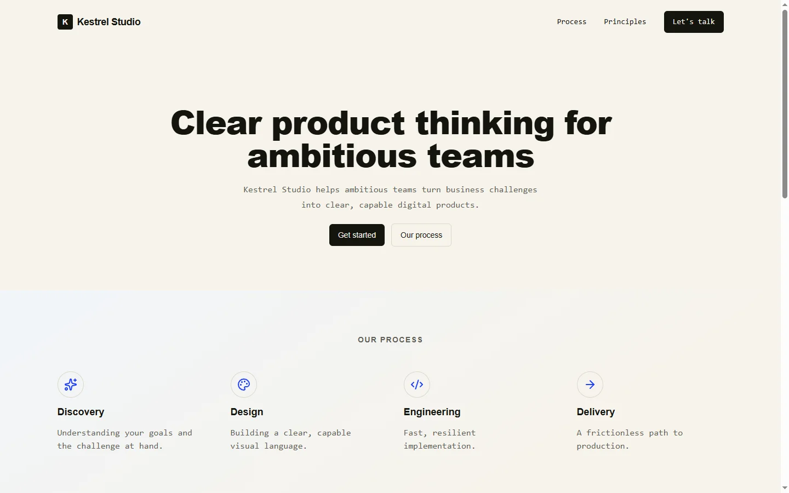

# Kestrel Studio

Digital product studio marketing landing page built with Next.js 16, React 19, TypeScript and Tailwind CSS v4.



## What it is

Kestrel Studio is a single-page digital agency landing site presenting product strategy, design process, core principles, and collaboration models for ambitious teams. It serves as an exploratory marketing concept and design showcase with no dynamic user authentication or payment processing backend.

## Why this over a digital-agency template

- **Tailwind CSS v4 engine.** Uses pure modern CSS theme variables without bloated legacy config files or extra style preprocessors.
- **Self-hosted and clean asset surface.** No external remote image dependencies, tracking pixels, or third-party proprietary font services.
- **Original visual assets.** Includes a custom-generated team collaboration graphic free of recognizable faces, trademarks, or copyrighted emblems.
- **Zero dead template code.** Stripped of shadcn boilerplate, unneeded UI wrappers, and non-functional social channels.

## Quick start

Requirements: Node.js 20.9+ and pnpm.

```bash
git clone https://github.com/JORDANROBERTO74/kestrel-studio.git
cd kestrel-studio
pnpm install
pnpm dev
```

Open <http://localhost:3000>.

| Command | What it does |
| --- | --- |
| `pnpm dev` | Start the local Next.js development server |
| `pnpm build` | Create an optimized production build |
| `pnpm start` | Serve the production build locally |
| `pnpm lint` | Run ESLint checks |
| `pnpm typecheck` | Run `tsc --noEmit` validation |

## Design system & Tokens

The visual foundation is anchored around an earthy editorial palette defined directly in `src/app/globals.css`:
- `paper` (`#F6F3EC`): Base surface canvas
- `ink` (`#15150F`): High-contrast typography and prominent action buttons
- `gray` (`#5F5E56`): Muted supportive text
- `line` (`#DDD7C8`): Structural borders and separators
- `accent` (`#1E3FFF`): Vibrant blue focal points and interactive hovers

## Project structure

```text
src/
  app/
    globals.css      # Design tokens, color definitions and baseline styles
    layout.tsx       # Root layout with metadata and analytics integration
    page.tsx         # Main entry point rendering the landing page
  components/
    KestrelLanding.tsx # Modular landing sections (Hero, Process, Principles, CTA, Footer)
public/
  cta-image.jpg      # Self-hosted generated studio collaboration image
  icon.svg           # Scalable favicon vector
docs/
  provenance.md      # Architectural derivation and asset compliance ledger
  screenshot.webp    # Production capture of the landing hero
```

## Deployment

Continuous deployment is linked via GitHub commits to Vercel:
1. Pushes to `main` branch trigger automated production deployments.
2. Production artifacts are served directly over Vercel's global edge network.

Live demo: <https://kestrel-studio-chi.vercel.app>

## Status and scope

Verified with clean TypeScript compilation, lint passes, and zero browser console errors on production viewport runs. Inquiries anchor to email links (`mailto:hello@kestrel.example`) as an illustrative concept.

## License

Proprietary, all rights reserved. See [LICENSE](LICENSE).
